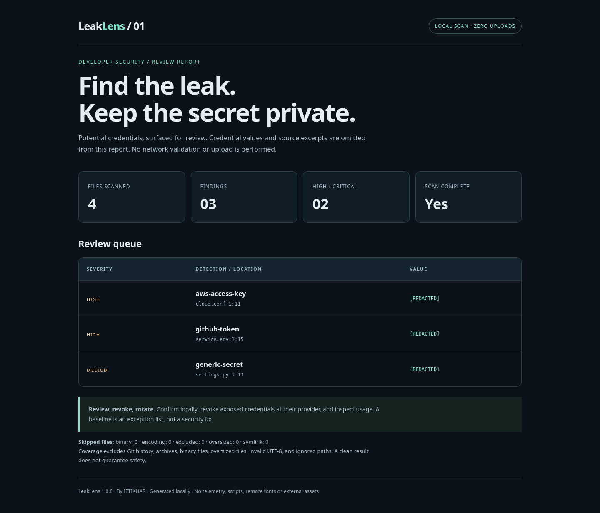
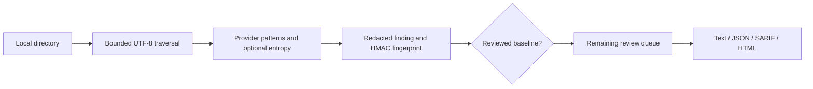

# LeakLens

**By IFTIKHAR** · Offline secret review · Python 3.11+ · MIT

[](https://github.com/specter-sec/leaklens/actions/workflows/ci.yml)

Find likely hardcoded credentials **before sharing a working directory**, without uploading source code or copying credential values into reports. LeakLens is a small, original, standard-library-only Python tool for developer laptops, Linux servers and Android Termux.

**Pehle local scan karo, phir findings review karo.** A detector is a second pair of eyes, not proof that a repository is safe.

## What you get

- Provider-shaped GitHub tokens, AWS access-key IDs, private-key headers and quoted generic secret assignments.
- An optional, deliberately noisy entropy detector for extra review coverage.
- Redacted terminal, JSON, SARIF 2.1.0 and self-contained HTML reports.
- Salted, reviewable baselines: suppress the same value in the same file even if its line moves; changed values are new findings.
- Deterministic directory traversal, explicit skip counts, size limits and no symlink following.
- No telemetry, network requests, credential validation, third-party runtime packages or automatic file changes.
- Unit and CLI privacy regression tests plus a Python 3.11/3.12/3.13 CI matrix.

## Real screenshot

This is the HTML report actually generated by LeakLens against `demo.py`'s fictional local fixtures—not a mockup. All displayed credential values are redacted. No real credentials were used.



## Try it in two minutes

```sh
git clone https://github.com/specter-sec/leaklens.git
cd leaklens
python3 --version  # 3.11 or newer
python3 -m leaklens --version
python3 -m leaklens scan /path/to/your/project
```

No installation is required when running from this checkout. To install an optional console command into your own virtual environment:

```sh
python3 -m venv .venv
. .venv/bin/activate
python -m pip install .
leaklens scan /path/to/your/project
```

The application has **zero runtime dependencies**. Optional packaging uses setuptools, which pip may download during build isolation; use the checkout command for a completely offline runtime. Termux: install `python` and `git` with `pkg install python git`, then use the same checkout commands. Android-specific packaging is not certified by this project.

### Safe demo

Choose **new, unused** paths. The generator refuses an existing directory; reports never overwrite files. The demo fixtures are invented, not usable credentials.

```sh
python3 demo.py /tmp/leaklens-demo
python3 -m leaklens scan /tmp/leaklens-demo
# Exit 1 is expected: the fictional fixtures intentionally contain matches.
python3 -m leaklens scan /tmp/leaklens-demo --format html --output /tmp/leaklens-report.html
python3 -m leaklens scan /tmp/leaklens-demo --format json --output /tmp/leaklens-report.json
python3 -m leaklens scan /tmp/leaklens-demo --format sarif --output /tmp/leaklens-report.sarif
```

Open the HTML file locally. It has no scripts, remote fonts, analytics or external assets. Store reports **outside the scanned root** to avoid scanning previous report metadata. Reports include relative filenames, line/column numbers, rule IDs and fingerprints—treat those as potentially sensitive metadata too.

### Exit codes for scripts and CI

| Code | Meaning |
| --- | --- |
| `0` | No unsuppressed findings and no scan I/O errors; or baseline creation succeeded |
| `1` | Potential credentials need review |
| `2` | Invalid arguments, invalid baseline, inaccessible input or incomplete scan |

`complete: true` means directory traversal finished without reported I/O errors. It does **not** mean every file or every possible secret was examined. Always inspect `skipped` and the coverage limits below. An incomplete scan wins over the findings exit code.

## Review baselines, not blanket ignores

```sh
python3 -m leaklens baseline /path/to/project --output /tmp/review-baseline.json
# Review EVERY underlying finding locally before adopting this exception list.
python3 -m leaklens scan /path/to/project --baseline /tmp/review-baseline.json
```

A baseline contains a version, a random 32-byte salt, and HMAC-SHA256 fingerprints—not raw secret values. Fingerprints bind the relative file path, rule and matched value; line numbers are intentionally excluded. Renaming a file or changing a value creates a new finding. The salt is public metadata, **not an encryption key**; low-entropy values can still be guessed offline. Keep baselines private when appropriate.

Baseline generation suppresses nothing by itself and refuses incomplete scans. It cannot distinguish a safe test fixture from a live leak. Never use a baseline as a substitute for rotating an exposed credential. Existing baseline/output files are never silently replaced by the CLI.

## Tune coverage

```sh
python3 -m leaklens scan ./project --exclude 'vendor/**' --exclude '*.min.js'
python3 -m leaklens scan ./project --max-bytes 2097152
python3 -m leaklens scan ./project --entropy --format json
```

Exclusions use Python `fnmatch` over relative POSIX paths, not Git ignore semantics. Quote shell patterns. `*` may cross `/`; patterns are case-sensitive. A trailing `/` or `/**` excludes a matching directory tree. **`.gitignore` is not read**: hidden files such as `.env` are intentionally inspected.

Default directory omissions: `.git`, `node_modules`, `.venv`, `venv`, `__pycache__`, `.pytest_cache`, `dist`, `build`. Symlinks, NUL-containing binaries, invalid UTF-8 and files larger than 1 MiB are skipped and counted. Do not scan a tree being modified by an untrusted process; file checks are not a hostile-filesystem sandbox.

## How it works



`scanner.py` owns traversal and matching, `rules.py` owns detection patterns, `baseline.py` owns baseline validation, `reports.py` owns serialization, and `__main__.py` owns CLI policy and exit codes. None of these modules phones home.

## Coverage and threat model

LeakLens helps catch **accidental hardcoded credentials in current local text files**. It does not scan Git history, staged Git blobs, archives, encrypted content, images, binaries or remote repositories. It does not verify that a match is live, validate AWS checksums, pair AWS IDs with secret keys, parse every language, or comprehensively detect all providers. An AWS access-key ID is an identifier requiring investigation, not by itself an authentication credential. Private-key detection finds headers, not complete or valid key material. Generic rules expect quoted assignments and miss unquoted, concatenated and multiline values. Entropy produces false positives. Placeholder filtering can produce false negatives.

Do not run this tool on repositories you are not authorized to inspect. No finding should trigger an automatic login attempt. Do not attach source lines or real credentials to issues. Even redacted reports disclose file locations and project structure. This is a focused educational developer utility, **not a replacement** for mature tools such as [Gitleaks](https://github.com/gitleaks/gitleaks) or GitHub's [push protection](https://docs.github.com/en/code-security/concepts/secret-security/push-protection).

## If you find a real leak

1. Revoke or rotate the credential at its provider; deleting a line does not revoke it.
2. Review account/service audit logs for unexpected use.
3. Remove the hardcoded value and use a suitable secret manager or environment injection.
4. Check Git history and every place the value was shared using an appropriate history scanner.
5. Re-scan; only baseline a verified exception after review.

## Test and contribute

```sh
python3 -m unittest discover -s tests -v
python3 -m compileall -q leaklens tests demo.py
python3 -m leaklens scan .
```

Tests generate synthetic token-shaped data at runtime and exercise redaction, traversal, baseline behavior and CLI/report safety. CI results are revision-specific: see [Actions](https://github.com/specter-sec/leaklens/actions). A command listing is not a claim that an arbitrary checkout passed. See [CONTRIBUTING.md](CONTRIBUTING.md) and [SECURITY.md](SECURITY.md).

### Roadmap

- Git-index scanning with explicit staged-content semantics.
- Additional reviewed provider patterns and a maintained coverage table.
- Separate baseline review tooling and expiry metadata.
- Cross-platform CI, including native Windows filesystem behavior.

Code and original documentation: [MIT](LICENSE). By **IFTIKHAR**. Independent project; no affiliation with credential providers.
